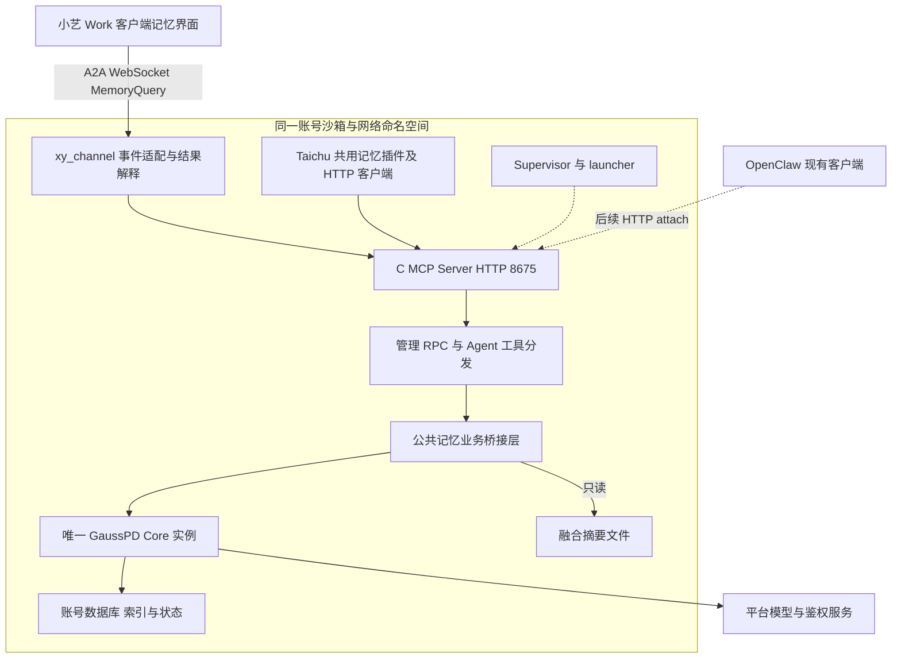
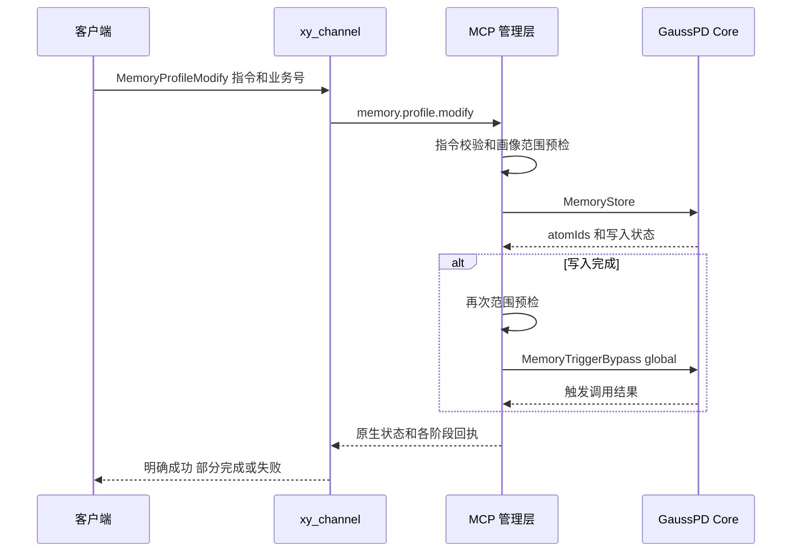
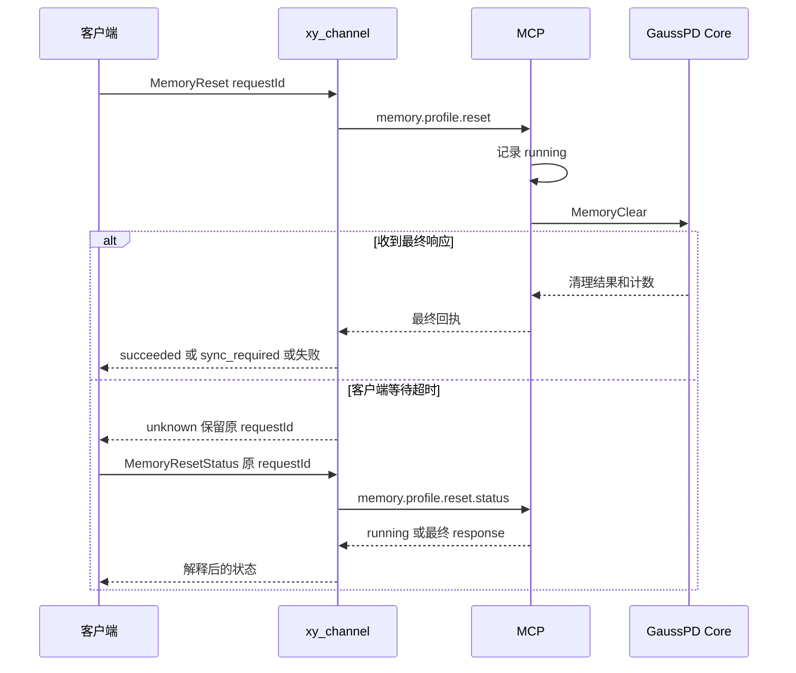

# 小艺 Work 云电脑记忆管理方案设计

技术方案  2026 年 11 月 18 日

小艺 Work 云电脑以公共 C MCP Server 作为 GaussPD 记忆系统的服务入口。Taichu 通过记忆插件调用 Agent 工具，xy_channel 将客户端的记忆界面事件转换为同一服务的账号管理接口；记忆数据、模型处理和后台管线继续由同进程 GaussPD Core 负责。

当前采用回环 HTTP JSON-RPC，地址为 `http://127.0.0.1:8675/mcp`，并保留独立部署的 stdio 兼容模式。界面管理与 Agent 工具共用同一账号、同一 Core 和同一数据目录，画像编辑、开关和重置的业务逻辑集中在 MCP 侧。

设计基线为 2026 年 11 月 18 日：云端集成仓 main 提交 `c3e68888d563`；xy_channel 分支 `openclaw6.6_0730`，基于 `a582a6a6c3e6` 的实现，本次频道适配及文档随合并请求交付。本文面向 MCP、Taichu、xy_channel、云电脑客户端及沙箱部署的开发和联调人员。

## 目标与交付范围

现有鸿蒙 PC 与云电脑使用同一套 GaussPD Core，通过各自胶水层适配宿主环境。云电脑方案复用已注册的 Taichu 记忆插件，并将与鸿蒙侧对齐的账号管理能力放入真实 C MCP 进程，使 Agent 和记忆界面操作同一份记忆。

| 能力 | 当前实现 |
| --- | --- |
| 记忆开关 | MCP 持久化开关并调整运行态；XY 提供查询和设置 action |
| 记忆展示 | MCP 读取用户画像、本地记忆及独立融合摘要；XY 提供快照分页 |
| 画像编辑 | MCP 校验指令并执行 Store 与 global TriggerBypass；XY 返回各阶段结果 |
| 账号记忆重置 | MCP 在现有 Core 实例上执行 Clear，返回各类存储计数和融合协同标志 |
| 重置状态查询 | MCP 独立记录和查询重置状态；XY 支持超时后的状态恢复 |
| 原子记忆更新 | MCP 已提供 memory_update 和 memory_update_attributes，云沙箱配置已启用更新管线；本轮 XY 管理 action 未扩展这两个工具 |
| stdio 兼容 | 保留原传输及旧调用约定；生产共享接入采用 HTTP |

本轮交付的是频道适配和服务端能力。云电脑客户端仍需接入 action 并实现按钮、编辑输入、分页和状态提示；平台仍需完成融合摘要文件与远端源的清除协同。

## 总体架构



同一账号的 HTTP 部署由 Supervisor 启动一个 MCP 进程。C main 创建 Core，业务桥接层借用该实例。多个客户端连接同一进程，各自不再创建第二个 Core 来写同一数据库。

现有 OpenClaw 客户端仍采用 spawn 加 stdio。服务端已具备统一 HTTP 能力，但 OpenClaw 调用方的 HTTP attach 迁移尚未完成。迁移时必须先停止旧 owner；HTTP owner 与旧 stdio owner 不能同时打开同一账号数据库。

HTTP 模式和 stdio 模式由同一可执行程序二选一运行。stdio 的保留用于兼容部署，不表示一个已运行的 HTTP 进程同时提供 stdio 入口。

## 模块划分与职责

### xy_channel

| 模块 | 主要职责 |
| --- | --- |
| WebSocket 与 monitor | 接受直接 A2A 和 msgDetail 包装报文，提取 MemoryQuery，传递信封中的 sessionId、taskId、messageId |
| memory-query-handler | 按配置选择 MCP 或旧文件模式，调用服务，使用原 sendCommand 回包 |
| memory/config | 校验显式启用项、回环 URL 和 token 文件路径 |
| memory/mcp-http-client | 读取私有 token，执行初始化探测，完成 HTTP 调用、传输关联和大小限制 |
| memory/service | action 映射、参数白名单、业务回执解释、重复写请求合并及并发视图失效 |
| memory/view | 保存会话快照、计算分页预算并保护 Unicode 边界 |
| memory/command | 保留批准的展示字段，生成不包含记忆正文的日志摘要 |
| formatter 与 outbound-gateway | 沿用 A2A 命令信封、发送链路和 streamingTextId 规则，记忆回包不打印正文 |

频道服务按配置对象复用 MemoryService，保证同一运行配置内的快照和重复写请求缓存能跨事件使用。配置或账号变化后重新创建服务。

### C MCP Server

| 模块 | 主要职责 |
| --- | --- |
| mcp_main | 解析启动配置、初始化唯一 Core、选择传输并管理退出生命周期 |
| mcp_config 与 caller_context | 解析运行配置，将已认证调用绑定到服务启动账号 |
| mcp_server | JSON-RPC、初始化、工具发现与通用消息分发 |
| mcp_memory_profile | 六个宿主管理方法、账号 owner、业务互斥、重置记录及刷新任务管理 |
| mcp_async | 四个异步分发线程，使长操作不阻塞 HTTP 事件循环 |
| memory/bridge | 适配公开 Core API，统一开关、画像、搜索、主动记忆、更新和重置等业务 |
| memory/memory_profile | 开关文件读写、运行态补偿、编辑指令字符校验 |
| tools 与 transport | Agent 工具协议及 HTTP、stdio 传输；嵌入页面用于 MCP 调试 |
| compat 与 third_party | MCP 自有 POSIX 支持及 cJSON 等依赖 |

### 云沙箱与 Core

task_level_sandbox 负责配置模板、构建、发布包、安装、Supervisor、就绪探测、升级回滚和部署测试。Python 只用于安装管理，实际 HTTP 服务由 C MCP 提供。

core 提供成对交付的公开头文件和动态库。记忆抽取、检索、分类、摘要、存储与后台调度由 Core 执行，蓝区通过公开 API 调用。

## 隔离边界与资源所有权

### 公共依赖与运行数据

集成仓保持 task_level_sandbox、mcp、core 三个业务目录。mcp 和 core 是可复用公共代码及依赖；task_level_sandbox 持有云电脑场景的构建、配置和部署逻辑。公共代码复用与运行账号隔离分别管理。

运行实例按账号绑定，启动前取得数据库所在目录的 owner 锁，恢复持久化开关，再初始化 Core。借用实例的桥接层不重复 Init、PostInitProbe 或 Finalize。最终 Core 生命周期由 C 主进程管理。

| 资源 | 所有者与约束 |
| --- | --- |
| Core 实例及数据库 | 单账号 MCP owner；普通客户端不直接访问 SQL 或索引 |
| 私有账号文件和 HTTP token | 安装器首次创建，覆盖安装沿用，权限 0600 |
| .xiaoyiruntime | MCP 管理 MEMORYSTATE，保留 MEMORYSYNC 等其它键 |
| 全局和场景记忆 | Core 维护，Agent 和管理接口通过同一实例访问 |
| global_summary_fused.md | Core fusion 或平台同步方提供，MCP 只读 |
| XY 展示快照和重复请求缓存 | 频道进程内内存状态，不作为持久数据 |

### 账号与任务

客户端的 UID、project_id、数据库路径或工作目录不能决定管理操作的账号。MCP 使用启动绑定账号，管理参数采用白名单；XY 也拒绝未声明参数。XY 的 cfg.uid 用于本地业务号关联，不替代 MCP 的账号鉴权。

sessionId 用于会话关联、编辑上下文和 XY 快照隔离。MemoryReset 的清理范围是当前绑定账号，不是当前 taskId 或 sessionId；客户端应在账号级清空入口使用该接口。

同一网络命名空间中的客户端可通过 127.0.0.1 共享 MCP。若任务隔离方案将客户端和公共 MCP 放入不同容器网络命名空间，需要另行安排可达的本地服务入口；当前 XY 校验只接受 127.0.0.1，不能直接把地址改成远程 IP。

## 通信协议与数据契约

### 客户端到 XY

客户端继续发送 AgentEvent.MemoryQuery，事件放在 A2A 的 params.message.parts 中的 data.events 数组。业务参数放在 payload.params，兼容唯一的 params.body 包装，两种形式不能混用。

```json
{
  "jsonrpc": "2.0",
  "id": "a2a-message-001",
  "method": "message/stream",
  "params": {
    "id": "task-001", "sessionId": "session-001",
    "message": {
      "role": "user",
      "parts": [{
        "kind": "data",
        "data": {"events": [{
          "header": {"namespace": "AgentEvent", "name": "MemoryQuery"},
          "payload": {
            "action": "MemoryProfileModify",
            "params": {
              "instruction": "以后记住我不吃香菜",
              "requestId": "edit-001"
            }
          }
        }]}
      }]
    }
  }
}
```

XY 使用相同 sessionId、taskId 和 messageId 回包。JSON-RPC 响应的 result.kind 为 artifact-update，result.final 为 true，result.artifact.parts 中的 data.commands 携带同名事件，payload 为 action 和 ans。外层仍使用原 agent_response WebSocket 信封。

### XY 到 MCP

HTTP 请求为 POST /mcp，Content-Type 为 application/json，Authorization 为 Bearer token。协议版本为 2025-03-26。当前不使用 SSE 或会话 token，通知可返回 HTTP 202。

```json
{
  "jsonrpc": "2.0",
  "id": "rpc-transport-001",
  "request_id": "edit-001",
  "method": "memory.profile.modify",
  "params": {
    "instruction": "以后记住我不吃香菜",
    "session_id": "session-001"
  }
}
```

首次业务调用前，XY 执行 initialize 和只读 settings.get 探测；探测失败则不发送该次业务请求。重置期间 settings.get 返回 Busy 时仍允许继续独立查询 reset.status。

六个管理接口直接使用 JSON-RPC method，不通过 tools/call 调用。Agent 工具使用 tools/list 发现，再通过 tools/call 调用。

### 三种关联标识

| 标识 | 含义 |
| --- | --- |
| A2A messageId | 关联客户端请求与 XY 回包，沿用既有信封 |
| MCP id | 单次 HTTP 传输 ID，XY 每次生成 UUID 并验证响应匹配 |
| requestId 与 request_id | 业务关联号；XY 参数为 camelCase，MCP 顶层为 snake_case |

重置状态查询的 params.request_id 指向原重置业务号；查询请求自身的传输 id 和顶层 request_id 与原清空操作分别管理。业务号用于关联和有限范围的防重复，不是持久化幂等凭证。

### 返回结果

管理 RPC 返回 JSON-RPC result 包裹的业务信封：

```json
{
  "jsonrpc": "2.0",
  "id": "rpc-transport-001",
  "result": {
    "status": 0,
    "result": {
      "atomIds": ["9223372036854775931"],
      "storeCompleted": true,
      "triggerAttempted": true,
      "triggerCompleted": true
    }
  }
}
```

XY 的 ans 提供 ok、code、requestId、outcome，以及可用时的 nativeStatus、result 和 errorCode。nativeStatus 保留 MCP 业务信封的 status；Core 原始调用状态和阶段详情继续保存在 result 内。HTTP 200 只表明收到协议响应，客户端必须检查业务结果。

atomIds 全程使用十进制 uint64 字符串，避免 JavaScript number 精度损失。

## 管理接口与 action 映射

七个 XY action 对应六个 MCP 管理方法，UserMdQuery 和 MemoryMdQuery 共用一次画像读取接口。

| XY action | MCP 方法 | XY 参数 |
| --- | --- | --- |
| MemoryStateGet | memory.profile.settings.get | 可选 requestId |
| MemoryStateSet | memory.profile.settings.set | memoryState 布尔值，可选 requestId |
| UserMdQuery | memory.profile.get | 可选 requestId、snapshotId、offset |
| MemoryMdQuery | memory.profile.get | 同上，可选 section 为 memoryMd 或 cloudGlobalSummary |
| MemoryProfileModify | memory.profile.modify | instruction，可选 requestId；信封必须有有效 sessionId |
| MemoryReset | memory.profile.reset | 可选 requestId、dryRun，默认正式执行 |
| MemoryResetStatus | memory.profile.reset.status | 必填原重置 requestId |

MCP 参数分别为：settings.get 使用空对象；settings.set 使用 enabled；profile.get 使用可选 session_id；modify 使用 instruction 和可选 session_id；reset 使用可选 dry_run；reset.status 使用 request_id。XY 编辑路径要求 sessionId，MCP 直接管理协议保留可选 session_id 的服务端约定。

### 开关返回

成功设置需要 enabled 等于请求值，且 applied 和 persisted 均为 true。XY 同时保留原 memoryState 布尔字段。运行态与文件无法恢复一致时，结果带 recoveryRequired，XY 返回 recovery_required。

### 展示返回

MCP 的 profile.get 返回 status 为 ok 或 not_found，以及 payload.userMd、payload.memoryMd、可选 payload.cloudGlobalSummary 和 meta.cloudSummaryFile。它们是通过 Core 接口及受控融合文件读取获得的当前视图，不保证等同于旧工作区同名文件。

XY 将指定部分放入 fileDetail，并附带分页、skipped、memoryEnabled、cloudSummaryAvailable 和 cloudSummaryFile 等信息。cloudSummaryAvailable 按当前摘要是否有非空正文计算；文件读取诊断仍应单独检查。

### 编辑与重置返回

编辑保留 atomIds、storeCompleted、triggerAttempted、triggerCompleted、scopePreflightPassed 及失败阶段。MCP status 为 0、写入和触发阶段均完成且 IDs 合法时，XY 才确认成功。

重置返回 account 范围、dryRun、coreClearCompleted、memoryRows、stateRows、indexRows、securityRows、failedRows、各类失败计数、nativeStatus、coreStatus、restartRequired 和 cloudSummaryResetRequired。XY 将预览、完整完成、结果未知和融合待同步分别解释。

## 业务流程

### 对话采集与画像生成

对话开始时，Taichu 的共用记忆插件通过全局加载取得用于 Agent 上下文的记忆。普通对话完成后，QA worker 调用 memory_add 采集原始问答；主动记忆调用 memory_store。Core 负责后续原子记忆、场景和全局摘要及后台调度。

XY 的界面管理路径不重复采集同一轮对话。界面通过 profile.get 查询当前画像，能否立刻看到最新摘要取决于 Core 相关处理是否已完成。

### 记忆开关

1. 客户端发送 MemoryStateSet，XY 将 memoryState 转为 enabled。
2. MCP 在受控数据目录修改 .xiaoyiruntime 中的 MEMORYSTATE，并应用 Core 分析运行态。
3. 应用失败时补偿开关文件和运行态；无法恢复一致时进入需要恢复的状态。
4. XY 核验 applied、persisted 和实际值，成功后回传 memoryState。

首次没有开关文件时默认启用，重启时在 Core Init 前恢复持久化值。关闭记忆会抑制分析、画像召回、主动抽取、更新和刷新；普通 Add 原始记录、允许的 raw_conv 查询及管理清空仍可继续。关闭开关不等于删除已保存数据。

### 展示与分页

首次 UserMdQuery 或 MemoryMdQuery 调用 profile.get，XY 将 userMd、memoryMd、cloudGlobalSummary 作为同一份会话快照保存。客户端可使用同一 snapshotId 分别读取三个部分，并用 nextOffset 续页。

偏移按 JavaScript UTF-16 位置计算，contentBytes 为当前页 UTF-8 字节数；分页不拆开 emoji 代理对。快照 30 秒有效，最多 16 份，文本总量不超过 4 MiB。不同会话不能访问彼此快照。

每页以 ans 双层 JSON 转义后 60000 字节为预算，为原 WebSocket 信封保留空间。写操作开始和结束都会使快照失效；跨越写操作返回的在途旧画像也不能发布为新快照。过期或淘汰返回 SNAPSHOT_EXPIRED，客户端重新从第一页读取。

MCP 和 Core 对返回内容仍有自身预算。XY 分页只拆分已经成功收到的视图，不能恢复上游已裁剪内容，也不能绕过业务桥接的大小限制。

### 画像编辑



编辑输入是自然语言更新指令，上限 8192 UTF-8 字节，并通过与鸿蒙侧对齐的字符校验。Store 失败不继续触发 global；已发生写入后后续步骤失败时保留 IDs 和阶段字段。triggerCompleted 表示触发 API 返回成功，真实模型形成何种画像仍需生产模型验收，页面需要重新读取当前视图。

### 重置与状态恢复

重置使用现有 Core 实例执行 MemoryClear，覆盖当前账号的 memory、state、index、security。dryRun 为 true 时只返回预览计数，不执行清空。预览和正式执行使用不同业务号。

重置原请求等待最终结果，MCP 为该业务号记录 running 及最终响应。重置期间其它受互斥保护的管理和业务请求返回 Busy，reset.status 可以独立查询。存在排队或运行中的刷新任务时，重置也会被拒绝为 Busy。



Clear 不重建 Core，也不隔离此前已经运行的 Core 后台任务。coreClearCompleted 为 true 且 cloudSummaryResetRequired 为 true 时，XY 返回 ok=false、outcome=sync_required。平台还需清除融合摘要文件与远端源，防止后续同步重新注入旧内容。仅看到 Core state=succeeded 不能将界面显示为全部清空完成。

## Agent 工具与记忆更新能力

管理 RPC 服务于受信宿主，Agent 工具服务于记忆插件和模型。二者共用同一 Core，但发现入口和返回封装不同。管理 RPC 不加入模型 tools/list，也不通过 tools/call 调用。

| 工具组 | 用途和当前接入 |
| --- | --- |
| memory_global_load、memory_scene_load | Agent 全局召回和场景加载 |
| memory_store、memory_record_search | 主动记忆与 atomic_fact、raw_conv 检索 |
| memory_refresh | ingest、scene、global 刷新提交及按 taskId 查询 |
| memory_add | QA hook 原始对话采集 |
| memory_global_summary_fetch | 宿主读取本地摘要和更新时间用于同步 |
| memory_update、memory_update_attributes | Core 原子记忆内容更新和分类场景属性纠错 |

Taichu 模型当前继续看到 global_load、scene_load、store、record_search、refresh 五个工具。memory_add 用于 hook，宿主画像管理 RPC 不暴露给模型。本轮 XY 管理适配也不新增原子 ID 级更新 action。

原子记忆内容更新分为预览和应用：先以 sessionId、sourceText 获取候选，再使用 targetMemoryIds 及 suggestedOperation 应用 expand、evolve、correct 或 delete。前三种操作需要 newInformation，delete 省略该字段。targetMemoryIds 最多 64 个十进制字符串 ID。

属性更新使用 targetAtomId、sourceText 和可选 fields，云沙箱模板允许 category、sceneTag、subSceneTags。Core 继续执行模型裁决、字段权限和值检查。pipeline.memoryUpdate.enabled 是更新管线开关，与用户 MEMORYSTATE 分别管理；用户关闭记忆时，蓝区仍阻止更新进入 Core。

MCP 的 memory_store 保留 OpenClaw status、count、ids 回执；Taichu HTTP 客户端将其转换为共用插件需要的 nativeStatus、storeCompleted、atomIds。status=0、count>0、合法 IDs 且工具 isError=false 才代表写入完成。无事实或关闭记忆的空 IDs 不能解释为已写入，写入完成本身也不表示摘要已更新。

工具回包通常为 isError 加文本 content，文本内再解析业务 JSON；六个管理方法则直接返回 status 与 result。各调用方必须按对应接口解释，不能混用封装。

## 并发与异常处理

### 执行模型

HTTP 事件循环负责连接和准入，四个异步线程执行分发。HTTP 最多 32 个在途请求，超限或无法受理时服务端在分发前返回 503。管理层使用业务互斥保护 Core 操作，冲突时优先返回 Busy；异步线程数不代表同一账号允许四个管理写操作同时执行。

### 重复请求保护

XY 对开关、编辑和重置建立进程内缓存。相同 requestId、同一会话、action 和规范化参数合并在途或已完成结果；同 ID 不同内容返回 REQUEST_ID_CONFLICT。最多 64 条，完成后保存 5 分钟，不为新请求提前淘汰仍有效的写记录；满额时返回 Busy。

未显式提供 requestId 时，XY 从配置账号、会话、action 和 A2A messageId 生成业务号。没有 requestId 或 messageId 的写操作会被拒绝。客户端应为写操作生成稳定业务号，重置尤其需要在发起前保存该号。

MCP 另保存最近 16 条重置观测；相同仍保留的业务号不重复 Clear，dry_run 冲突会被拒绝。刷新任务保留最多 64 条记录。这些记录均不跨进程重启，不构成跨客户端、跨配置或长期持久的幂等保证。编辑和原子更新没有独立的持久结果查询接口。

### 客户端结果解释

| outcome | 含义与客户端处理 |
| --- | --- |
| succeeded | 操作要求的阶段已确认完成 |
| preview | 重置预览，仅展示预计范围和计数 |
| running | 重置仍执行中，用原业务号继续查询 |
| skipped | 关闭记忆导致跳过；展示可为 ok=true 的空视图，编辑为未执行 |
| busy | 暂时无法受理；保留业务上下文，交互层明确提示 |
| partial | 按已确认的写入阶段或清理计数标识部分完成，展示原始 result 详情 |
| sync_required | Core 完成清理，融合源仍待平台同步清除 |
| recovery_required | 开关文件和运行态未能恢复一致，需要宿主处理恢复 |
| rejected | 参数校验、请求号冲突或已确认认证拒绝等 |
| configuration | 缺少显式配置，或 token 文件等配置不合法 |
| unavailable | 只读启动探测未通过，该次业务请求未发送 |
| failed | MCP 已返回可解释的业务失败 |
| unknown | 超时、断连、无效回执或状态无法确认，禁止自动补发写操作 |

XY 不进行 HTTP 写重试，不跟随重定向。业务调用的 401、403 是已确认的认证拒绝；其它无法验证的传输结果保守归为 unknown。探测阶段失败统一作为 unavailable，token 文件校验错误保留配置错误类型。

reset.status 的 state 为 not_found 或 unknown 时，不能推断原操作未执行。即使查询收到最终结果，原超时写请求的 XY 缓存仍可保留 unknown；客户端以状态查询响应更新界面，不通过重发 Clear 来恢复。

### 容量和时间预算

| 项目 | 当前限制 |
| --- | --- |
| XY HTTP 建连、探测、业务 | 3 秒、每次探测 RPC 5 秒、业务 RPC 30 秒 |
| HTTP 请求、响应 | 请求最多 64 KiB，响应最多 512 KiB |
| 业务桥接 JSON | 内部另有 64 KiB 上限 |
| 编辑指令 | 8192 UTF-8 字节 |
| 业务号 | XY 使用 1 至 255 UTF-8 字节字符串，拒绝控制字符 |
| 融合文件读取 | 最多 64 KiB，带 readBytes、acceptedBytes、truncated 诊断 |
| XY 分页 ans | 双层 JSON 编码后最多 60000 字节 |
| XY 快照 | 30 秒，最多 16 份，文本总量 4 MiB |
| XY 写记录 | 最多 64 条，完成后 5 分钟 |
| MCP 重置观测 | 最近 16 条，仅当前进程 |

各层预算分别生效。HTTP 能承载 512 KiB，不代表 Core 管理视图或内部桥接能接受同等体积。

## 配置与部署

### XY 启用配置

在既有完整频道配置中增加 memory，不更改原 apiKey、agentId、uid、apiId、pushId 等必填项：

```json
{
  "channels": {
    "xiaoyi-channel": {
      "memory": {"backend": "mcp-http"}
    }
  }
}
```

将下列环境传入运行 XY 的宿主进程：

```sh
export CELIA_MEMORY_HTTP_URL=http://127.0.0.1:8675/mcp
export CELIA_MEMORY_HTTP_TOKEN_FILE=/absolute/private/path/.mcp_auth_token
```

token 文件为安装器生成的 64 位十六进制文本，可带结束换行，权限仅所有者可访问且必须为普通文件；XY 拒绝符号链接，并对非 root 的读取者校验文件所有者。token 不由客户端传入，不放在频道配置正文或 URL 中。

URL 只接受 http、127.0.0.1 和 /mcp，不接受 URL 凭据、查询参数或片段。HTTP 客户端直连回环地址，不使用环境代理。端口改变时，MCP、XY 和 Taichu 必须同时对齐。

### 服务启动与账号绑定

默认安装根为 /home/sandbox/.taichu/workspace/uid-virtual/agent_instances/sys_celia_main/agent_config，账号 memory 数据目录位于其同级。安装器绑定 CELIA_MEMORY_USER_ID，渲染模型地址、数据库、日志和端口；平台提供 Core 原生 sandbox 模型鉴权环境。

服务启动链为 Supervisor、launcher、manage.py launch、exec C MCP。安装器保存 .memory_account 和 .mcp_auth_token，MCP 从启动环境取得对应凭据。同一数据目录拒绝更换账号。

构建使用配套 Core 公开头文件与 Linux 动态库。build.sh 构建 MCP；package.sh 打包 MCP、Core、配置、launcher、安装脚本和校验信息。公共 MCP 也可独立构建，stdio-only 构建可关闭 HTTP。

平台先启动 MCP 并确认 RUNNING 与 mcp_ready，再向 XY 和 Taichu 分发正确配置。Taichu 还需显式选择 Celia 记忆插件，并保留现有其它插件条目。

### 升级与退出

升级前停止各客户端新请求并排空已受理业务。Taichu 现有退出上限为 60 秒，平台窗口至少 65 秒；超限退出 124 时写结果未知。部署编排还需停止 XY 新的管理写请求。

随后停止 MCP。MCP 排空已受理请求和刷新，按记忆开关策略 Flush，再 Finalize。Supervisor 停止窗口为 320 秒，强制终止不能视为保存完成。

覆盖安装保留账号、token、数据库、开关和融合数据；升级失败回滚受管理文件与 program。卸载同样保留数据和相关账号凭据。旧 OpenClaw 数据迁移由平台停写后校验和恢复，本仓不自动搬库。

## 兼容策略与客户端适配要求

### 既有行为

未配置 memory 时，XY 保留原文件模式。启用 MCP 后，七个管理 action 固定进入 MCP；HTTP 失败时返回错误，不退回旧 USER.md、MEMORY.md 或本地开关文件。

MemoryFileRead、MemoryFileWrite 保留原受限 Markdown 文件同步用途，不写 Core 数据库目录，也不替代画像编辑。MCP 模式下 MemoryHistory 返回 MEMORY_HISTORY_UNSUPPORTED，避免把旧文件历史当成 Core 历史。

HTTP 已供 Taichu 与本轮 XY 适配使用。原 OpenClaw 客户端迁移 HTTP attach、生产沙箱模型联调及客户端页面接线分别由后续集成完成。

### 客户端交互要求

客户端进入记忆页时查询开关和当前视图，按 snapshotId 读取各部分并续页。修改开关成功后重新读取状态和视图，关闭时明确展示关闭状态，不将空视图描述为删除成功。

编辑页提交自然语言指令和稳定 requestId，等待阶段回执。成功后重新拉取画像；partial、skipped、unknown 分别提示已确认阶段、未执行或结果待确认，不能统一展示保存成功。

账号重置入口区分 dryRun 和正式执行。正式操作前保存业务号，超时后查询原业务号；running 继续查询，sync_required 提示 Core 已清理但融合记忆仍待同步，只有完整业务回执满足条件时显示对应完成状态。

客户端不可向接口传 token、UID、数据库路径或自选账号。请求重发策略必须尊重业务号和未知结果语义。

### 日志

XY 对记忆输入原始帧省略正文；handler 和 outbound 只记录 action、布尔成功、数值状态和内容长度等摘要。成功展示的 fileDetail、MemoryFileRead.content 按业务保留原文，其它字段继续遵循原传输规则。

MCP 管理日志记录固定阶段、状态和计数，不打印画像、编辑指令或 token。stdio 日志走 stderr，stdout 用于协议响应。

## 验证与后续验收

### 已完成验证

| 层级 | 验证结果与范围 |
| --- | --- |
| XY 构建 | OpenClaw 2026.6.6、TypeScript 5.9.3 环境下 npm run build 成功 |
| XY 全量回归 | Vitest 2.1.9，41 个测试文件、379 项通过 |
| XY MCP 契约 | 18 项，覆盖接口映射、开关恢复、分页、并发失效、重复请求、部分完成及超时查询 |
| A2A 和日志 | 覆盖直接及包装 WebSocket、handler 回包、formatter 展示保真、出站日志和旧文件接口 |
| 真实 C MCP 联调 | XY 适配器连接真实 C HTTP 服务，验证开关、展示、编辑、重置和状态；底层使用测试 Core |
| MCP CTest | 2026 年 11 月 18 日本次复核 9 项全部通过，含借用实例、HTTP 与 stdio、画像范围、开关、重置、调度、Store 和搜索 |

云沙箱另提供配置、打包、Supervisor 生命周期测试，以及真实 Linux Core 的离线 smoke。离线 smoke 用隔离数据和未监听模型端点验证 ABI、启动和参数路径；生产模型改写、抽取及属性裁决效果需要在线验收。

### 联合验收

1. 在真实账号沙箱启动唯一 MCP owner，确认 8675 回环可达、token 一致、模型鉴权有效。
2. 从真实客户端经 XY 完成开关、三部分展示、编辑、分页和账号清空；验证 A2A 关联及界面提示。
3. 使用真实 Core 与模型确认普通对话采集、主动记忆、画像更新和重启持久化。
4. 验证清理后的融合文件与远端源同步，确认旧内容不会重新注入。
5. 验证 Taichu、XY 并发访问、重置 Busy、HTTP 超时后状态恢复及服务重启后的 unknown。
6. 完成 OpenClaw HTTP attach 后，确认旧 stdio owner 已退出，同一数据库只有一个写 owner。

完成上述联合验收后，才能把本地契约通过与生产端到端记忆效果一并作为上线依据。

## 实现定位

以下链接定位本仓实现及配套 MCP 基线；跨仓 MCP 链接需要对应 GitHub 仓库访问权限。

| 主题 | 代码入口 |
| --- | --- |
| XY 频道配置 | [配置解析](../src/config.ts) 与 [MCP 配置](../src/memory/config.ts) |
| XY A2A 入口 | [WebSocket](../src/transport/websocket.ts) 与 [MemoryQuery handler](../src/memory-query-handler.ts) |
| XY 接口及结果解释 | [MemoryService](../src/memory/service.ts) |
| XY HTTP 与快照 | [HTTP 客户端](../src/memory/mcp-http-client.ts) 与 [快照分页](../src/memory/view.ts) |
| MCP 主进程与管理方法 | [C main](https://github.com/JcLichao/integration-celiaworks_cloud/blob/c3e68888d563a709c4b80f3fcb4939fdf79cecf3/mcp/core/mcp_main.c) 与 [管理分发](https://github.com/JcLichao/integration-celiaworks_cloud/blob/c3e68888d563a709c4b80f3fcb4939fdf79cecf3/mcp/core/mcp_memory_profile.cpp) |
| Core 业务桥接 | [bridge](https://github.com/JcLichao/integration-celiaworks_cloud/blob/c3e68888d563a709c4b80f3fcb4939fdf79cecf3/mcp/memory/bridge.cpp) 与 [开关及指令校验](https://github.com/JcLichao/integration-celiaworks_cloud/blob/c3e68888d563a709c4b80f3fcb4939fdf79cecf3/mcp/memory/memory_profile.cpp) |
| HTTP 和 stdio | [HTTP 传输](https://github.com/JcLichao/integration-celiaworks_cloud/blob/c3e68888d563a709c4b80f3fcb4939fdf79cecf3/mcp/transport/mcp_http.c) 与 [stdio 传输](https://github.com/JcLichao/integration-celiaworks_cloud/blob/c3e68888d563a709c4b80f3fcb4939fdf79cecf3/mcp/transport/mcp_stdio.c) |
| 云沙箱部署 | [manage.py](https://github.com/JcLichao/integration-celiaworks_cloud/blob/c3e68888d563a709c4b80f3fcb4939fdf79cecf3/task_level_sandbox/script/manage.py) 与 [部署说明](https://github.com/JcLichao/integration-celiaworks_cloud/blob/c3e68888d563a709c4b80f3fcb4939fdf79cecf3/task_level_sandbox/README.md) |
| XY 接入及测试说明 | [接口说明](../docs/memory-mcp-interface.md) 与 [契约用例](../tests/support/memory-mcp-cases.ts) |

后续若修改 method、action、回执语义或运行边界，应同步维护客户端接口说明、对应契约测试和本方案中的映射及异常处理规则。
