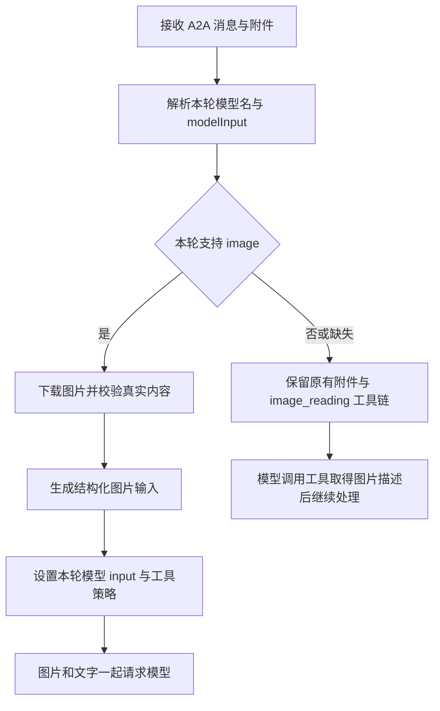

# 小艺 Channel 多模态模型支持改造说明

日期：2026-11-09

需求负责人：沈希扬

实现分支：`feat/model-input-multimodal-20261110`（基于 `openclaw6.6_0730`）

代码基线：`b8177cb`

状态：实现和本地验证已完成；本功能分支用于私仓评审和联调，真实端侧及云端模型网关待联调。

## 1. 改造目标与行为变化

落实整体改造方案第 7 点：Channel 根据每条请求中的 `modelInput` 判断当前模型是否支持图片，选择原生图片输入或原有图片理解工具链。

| 场景 | 改造后的行为 |
|---|---|
| `modelInput` 为合法字符串数组，包含精确的 `"image"` | 图片与文字一起请求当前模型 |
| `modelInput` 为 `["text"]` 或空数组 | 继续使用 `image_reading` 工具链 |
| 字段缺失、`null`、类型错误或数组中存在非字符串元素 | 默认按不支持原生图片处理 |
| 上一轮支持图片，本轮未传字段 | 本轮恢复文本模式，不继承上一轮图片能力 |
| 执行中追加原生图片或改变模型/图片能力 | 排队进入完整的新一轮执行 |
| 原生图片下载或校验失败 | 当前请求明确失败，不继续无图调用模型 |

Channel 直接消费消息中的能力声明，无需拉取运营平台的模型列表。能力判断不依赖模型白名单、设备类型或 App 版本，也不修改全局模型目录。

本次实现范围为图片输入；音频、视频等其他模态不在本次改造范围。

## 2. 新增协议字段

字段位置：

```text
params.message.parts[].data.variables.clientVariables.modelInput
```

`modelInput` 类型为原生 JSON 字符串数组，与现有 `modelName` 放在同一个 `clientVariables` 对象中。`modelName` 沿用模型列表中的 `modelValue`。

完整请求示例：

```json
{
  "jsonrpc": "2.0",
  "method": "tasks/send",
  "id": "integration-message-001",
  "params": {
    "id": "integration-conversation-001&interaction-001",
    "sessionId": "integration-conversation-001",
    "message": {
      "role": "user",
      "parts": [
        {
          "kind": "text",
          "text": "请描述图片中的内容"
        },
        {
          "kind": "file",
          "file": {
            "name": "picture.png",
            "mimeType": "image/png",
            "uri": "https://YOUR-FILE-SERVICE/picture.png?SIGNED-PARAMETERS"
          }
        },
        {
          "kind": "data",
          "data": {
            "variables": {
              "clientVariables": {
                "modelName": "YOUR-MULTIMODAL-MODEL-VALUE",
                "modelInput": ["text", "image"]
              }
            }
          }
        }
      ]
    }
  }
}
```

将示例中的模型名和图片 URL 替换为联调环境实际值，图片 URL 需要能被云沙箱下载。

解析规则有两项额外约束：

- 字符串 `'["text","image"]'` 不等于数组，按非法类型回退；`"IMAGE"`、`" image "` 也不会开启图片能力。
- 多个 data part 中出现模型声明时，名称和能力取自同一个首个声明对象。不会把前一份声明的模型名与后一份声明的图片能力拼接使用。只有模型名、没有能力的旧声明仍按文本模式处理。

## 3. 实现链路



### 3.1 统一保存本轮能力

新增公共能力模块，输出本轮的 `input`、`supportsNativeImages` 和声明来源 `source`。来源区分合法声明、缺失和非法输入，便于日志排查。

能力与模型名通过现有 `SessionContext` 和 `AsyncLocalStorage` 传播。Provider、图片处理和工具过滤使用同一份本轮信息，避免不同会话或不同轮次相互影响。

### 3.2 在图片加载前声明模型能力

现有动态模型解析固定返回 `input: ["text"]`，会使 OpenClaw 跳过原生图片加载。本次增加 `normalizeResolvedModel`，让静态配置模型和动态模型均能在图片加载前应用本轮能力。

- 支持图片时设置为 `["text", "image"]`，否则设置为 `["text"]`。
- 返回模型对象副本，仅覆盖 `input`，保留原来的接口地址、请求头、上下文长度和输出上限等参数。
- 动态解析和最终请求包装复用相同策略，不在每轮工具调用或重试时重复追加图片。
- 没有本轮 Channel 能力上下文时保留原有 Provider 行为，避免全局影响其他入口。

### 3.3 图片内容真正进入请求体

原生路径复用附件下载，并增加真实 MIME 检测和完整解码校验。通过 SDK 生成最多 64px 的验证预览后丢弃预览，保留原始图片字节；后续仍由 OpenClaw 按配置执行图片缩放。

随后通过 `replyOptions.images` 传入结构化图片内容，使用 `imageOrder: inline` 保持顺序。保留原有 `Media*` 附件引用，由框架标准附件提示配合图片顺序去重。

当前 OpenAI 兼容接口最终输出的图片结构为：

```json
{
  "type": "image_url",
  "image_url": {
    "url": "data:image/png;base64,..."
  }
}
```

本轮局部配置同时关闭 OpenClaw 通用前置图片理解，避免框架按静态模型目录再次识图。不会修改全局配置，音频、视频及其他配置保持原有设置。

### 3.4 图片工具按能力切换

原生图片模式在现有设备和 App 版本过滤之后隐藏 `image_reading`；文本模式保留该工具。工具说明也从无条件“有图必须调用”改为条件调用，避免图片已入模后重复识图。

原有工具链仍由模型发起工具调用。本次没有增加确定性的前置 OCR，因此不保证首次请求主模型之前已经完成图片理解。

### 3.5 追加图片与模型切换按顺序处理

原有 direct steer 只能注入文本。本次对带原生图片或模型/能力变化的消息使用完整新轮次，并在同一 A2A conversation 内设置排队屏障，后续文本不能越过待处理的图片消息。相同模型与能力的普通文本可继续使用 direct steer。

新轮次在任务注册、模型更新和派发之前严格检查 SDK 活跃 run 是否结束。旧 dispatch 等待完成后，SDK 状态检查额外最多等待 30 秒；仍未释放或检查异常时，当前请求下发失败终态。队列及上一轮执行等待不计入这 30 秒。

强制新轮次使用局部 `followup` 队列配置，防止框架内部再次将图片请求转成纯文本 steer。普通旧文本回退路径保留原有三秒宽松等待逻辑。

能力快照只在本轮完成准备并准入派发时更新，失败图片不会污染旧任务的能力。队列和能力按 A2A conversation 隔离，支持同一 WebSocket 外层 session 承载多个会话。取消请求保持即时处理，monitor 停止后不再启动待处理消息。

## 4. 错误处理与兼容边界

| 项目 | 处理方式 |
|---|---|
| 单图大小 | 跟随 SDK `MAX_IMAGE_BYTES`，本地 OpenClaw 2026.6.6 为 6 MiB |
| 图片内容 | 校验实际 MIME 和解码结果，拒绝空图、坏图、仅剩文件头的截断图及超限图片 |
| 图片处理器缺失 | 返回明确的环境处理错误，避免将合法图片误判为用户上传错误 |
| 多图部分失败 | 整条原生图片请求明确失败，不静默遗漏失败图片继续回答 |
| 失败终态 | 发送 failed 状态及 final 错误，新版任务卡同步收尾；仅清理本消息 task |
| 原有运行任务 | 本次图片失败或准入失败不会清理旧任务，也不会更新旧模型选择 |
| 同名附件 | 文件名增加 UUID，避免同名附件互相覆盖 |
| 附件 MIME 缺失 | 按位置补 `application/octet-stream`，避免媒体数组索引错位 |
| Kimi → MiniMax 降级 | 请求上下文含当前或历史图片时禁用未经确认图片能力的 MiniMax-M3 降级；纯文本保留原降级 |

原生路径未直接套用旧 `image_reading` 工具的十张上限。实际模型网关的多图数量、格式和总包大小仍需要联调确认。

长对话压缩当前只总结文本，本次未实现视觉摘要。文本模型追问历史图片仍依赖保留的原图引用和图片工具，临时文件清理后需要重新上传。

## 5. 主要代码改动

以下链接指向本分支源码，文件名按仓库内路径展示。

| 文件 | 主要变化 |
|---|---|
| [src/model-input.ts](../src/model-input.ts) | 新增能力校验、附件分类、模型选择变化判断 |
| [src/parser.ts](../src/parser.ts) | 解析 `modelInput`，保证模型名与能力来自同一声明对象 |
| [src/tools/session-manager.ts](../src/tools/session-manager.ts) | 在会话上下文中携带本轮能力 |
| [src/provider.ts](../src/provider.ts) | 提前应用模型能力、保证出站一致性、限制不兼容的图片降级 |
| [src/native-images.ts](../src/native-images.ts) | 新增真实图片读取、MIME 检测、完整解码和 SDK 图片准备 |
| [src/file-download.ts](../src/file-download.ts) | 原生图片下载大小限制、UUID 文件名 |
| [src/dispatch/bot.ts](../src/dispatch/bot.ts) | 图片传入、严格新轮次准入、局部配置、统一准备失败响应 |
| [src/dispatch/monitor.ts](../src/dispatch/monitor.ts) | 按 conversation 排队、准入后更新能力、停止后的队列保护 |
| [src/dispatch/inbound-admission.ts](../src/dispatch/inbound-admission.ts) | 新增会话串行队列和防止消息越过的屏障 |
| [src/channel.ts](../src/channel.ts) | 按本轮能力过滤图片理解工具 |
| [src/tools/image-reading-tool.ts](../src/tools/image-reading-tool.ts) | 将工具说明调整为条件调用 |

全量回归还发现原分支已有的记忆日志测试失败。本次在 [outbound-gateway.ts](../src/conversation/outbound-gateway.ts) 做了独立的小修复：`MemoryFileRead` 原文保持发送，日志仅记录动作、成功状态和字节数；混合批次中的其他命令保留原日志行为。

## 6. 验证结果

本地验证环境：OpenClaw `2026.6.6`，Node.js `24.18.0`。

| 检查 | 结果 |
|---|---|
| `npm test` | 32 个测试文件、254 项测试全部通过 |
| `npm run build` | 通过 |
| `git diff --check` | 通过 |
| 联调包检查 | 7 个关键运行文件存在，已生成 SHA-256 校验值 |

新增或扩展的测试覆盖：

- 字段缺失、非法类型、大小写及空白边界，多份声明的原子解析。
- 原生模式工具隐藏、文本模式工具恢复、原有设备和 App 版本过滤。
- 静态及动态模型能力、本轮参数保留、真实 ALS 并发隔离。
- 真实 SDK 图片解码、两图去重、坏图、截断图、超限图和图片处理器不可用。
- 真实 SDK HTTP 序列化：原生模式包含 `image_url`，文本及缺字段模式不包含图片数据。
- 带图追问、模型切换、消息顺序、失败不污染旧能力、同一传输下的会话隔离。
- SDK run 残留、严格准入超时、取消与清空上下文、monitor 停止后的队列保护。
- 现有会话锁、终态帧、识图工具超时、定时任务及记忆相关回归。

HTTP 测试使用真实解析、图片处理、Provider 和 SDK 序列化代码，传输及响应使用模拟环境。尚未接入真实手机/Web/PC端和云侧模型网关，不能将本地通过等同于端到端联调通过。

## 7. 联调重点与回退方式

建议按以下顺序联调：

1. 确认端侧和云侧将 `modelInput` 以原生数组透传，并与当前 `modelName` 一致。
2. 用支持图片的实际模型验证单图、多图、纯图片消息，确认最终请求包含图片且没有重复识图。
3. 使用 `["text"]` 和缺失字段分别验证原工具链，确认主模型请求不含图片。
4. 在同一会话切换多模/文本模型，并在流式处理中追加图片及后续文本，检查顺序和终态。
5. 验证沙箱图片处理器、图片 URL 可达性、网关 data URL 支持，以及格式和大小限制。
6. 检查部署环境的 `xiaoyi-image-understanding` Skill，原生图片已提供时不能继续强制调用 `image_reading`。该 Skill 正文未包含在本仓库。

观测日志可搜索 `[MODEL-INPUT]`、`[MODEL-INPUT-FILTER]`、`[BOT-STEER]` 和 `[BOT-DISPATCH]`，核对声明来源、能力、图片数量、工具列表和新轮次准入结果。

快速回退：端侧暂不传 `modelInput`，或传 `["text"]`，该次请求即恢复原有工具路径，无需修改全局模型白名单。

## 8. 构建与交付

本分支提交源码、测试、本文和 [详细联调说明](model-input-integration.txt)。编译输出和安装包未纳入源码仓库。

在仓库根目录执行：

```sh
npm run build
npm pack
```

安装包沿用仓库现有版本号 `0.0.25-release20261029`；临时联调部署时，请同时核对功能分支及提交号。
